# Macaque Template Surfaces — FreeSurfer & GIfTI cortical surfaces for NMT2, MEBRAINS, Yerkes19 and D99

[](https://brainana.readthedocs.io/)
[](https://www.biorxiv.org/content/10.64898/2026.06.03.729972v2)


Ready-to-use **cortical surface reconstructions for the most widely used rhesus macaque (*Macaca mulatta*) MRI templates** — NMT v2 (symmetric and asymmetric), MEBRAINS, Yerkes19 and D99 — with **brain atlases projected onto the surface** (CHARM, D99, Macaque Brainnetome Atlas (MacBNA), retinotopy, somatotopy, functional networks, cortical hierarchy and functional connectivity gradients), the same set on every template.

Each template comes as a full FreeSurfer-style subject directory (white, pial, inflated, sphere, curvature, sulcal depth, cortical thickness) plus GIfTI copies (`.surf.gii`, `.func.gii`, `.label.gii`), so you can use them directly in FreeSurfer, Connectome Workbench, nilearn, nibabel, NiiVue or any other surface tool for non-human primate (NHP) neuroimaging.

## Templates

- **NMT2** — [NMT v2](https://afni.nimh.nih.gov/pub/dist/doc/htmldoc/nonhuman/macaque_tempatl/template_nmtv2.html) 0.5 mm symmetric (**Sym**) and asymmetric (**Asym**) template
- **MEBRAINS** — [MEBRAINS 1.0](https://doi.org/10.1162/imag_a_00077) population-based macaque template
- **Yerkes19** — [Yerkes19](https://doi.org/10.1093/cercor/bhr290) macaque template [(balsa)](https://balsa.wustl.edu/reference/976nz)
- **D99** — [D99](https://doi.org/10.1016/j.neuroimage.2021.118759) template

## Quick start

```bash
git clone https://github.com/xingyu-liu/macaque_template_surfaces.git
cd macaque_template_surfaces

# FreeSurfer: view the CHARM level-1 parcellation on the NMT2Sym inflated surface
freeview -f sub-NMT2Sym/surf/lh.inflated:annot=sub-NMT2Sym/atlas/atlas-CHARM1_space-NMT2Sym_hemi-lh.annot
```

```python
# Python: load a GIfTI surface and a surface atlas with nibabel / nilearn
import nibabel as nib
from nilearn import plotting

mesh = "sub-NMT2Sym/surf/lh.inflated.surf.gii"
d99 = nib.load("sub-NMT2Sym/atlas/atlas-D99_space-NMT2Sym_hemi-lh.func.gii").darrays[0].data
plotting.plot_surf_roi(mesh, roi_map=d99, hemi="left", view="lateral")
```

## Generation

Surfaces were derived from the white and pial surfaces provided with each volume template, along with NMT [CHARM](https://afni.nimh.nih.gov/pub/dist/doc/htmldoc/nonhuman/macaque_tempatl/atlas_charm.html) and [SARM](https://afni.nimh.nih.gov/pub/dist/doc/htmldoc/nonhuman/macaque_tempatl/atlas_sarm.html) parcellations.

The full FreeSurfer-style pipeline (sphere, cortical ribbon, curvature, thickness, etc.) was completed using **Brainana**—an end-to-end non-human primate MRI volume and surface preprocessing pipeline.

- Documentation: <https://brainana.readthedocs.io/>
- Preprint: [bioRxiv](https://www.biorxiv.org/content/10.64898/2026.06.03.729972v2)

Use Brainana to process your own macaque anatomical and functional MRI data into the same surface space and format.

## Volumetric atlas projection on surface

Volume atlases were sampled at 11 depths between the white and pial surfaces and limited to the cortex label. Label atlases keep the most common label across depths, and unlabelled cortex vertices take their neighbours' label. Continuous maps keep the value nearest mid-thickness and are not filled.

Each `atlas/` folder has an `atlas-<name>.bib` with the references for that atlas (please cite them when you use it) and, for label atlases, the label table `atlas-<name>.tsv`. See [atlas-retinotopy_info.md](atlas-retinotopy_info.md) for the layout of the retinotopy maps.

Atlases that are not provided in a template's space were first warped from NMT2Sym (ANTs SyN, nearest neighbour; FuncConnGrad from Yerkes19). FuncNetwork, CortHierarchy and FuncConnGrad cover the left hemisphere only. On Yerkes19 they are the original fs_LR surface data, not a volume projection.

## Quality control

All atlases are available on every template; atlas QC figures are shown for NMT2Sym only (the others are in each `sub-<T>/QC/` folder).

<details>
<summary><b>NMT2Sym</b></summary>

Tissue segmentation
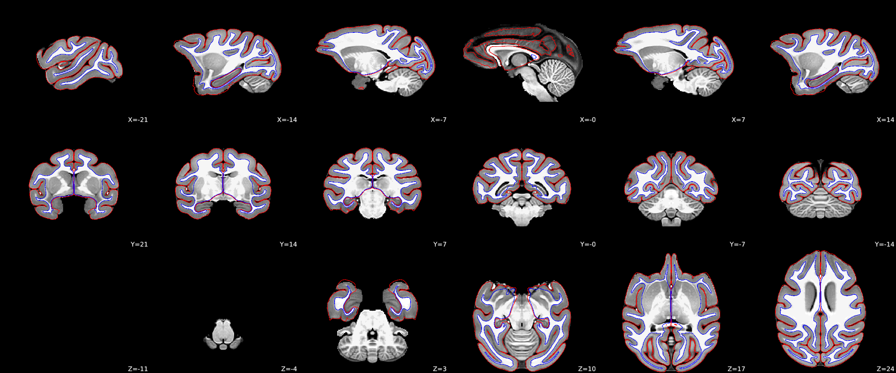

Cortical surfaces and measures
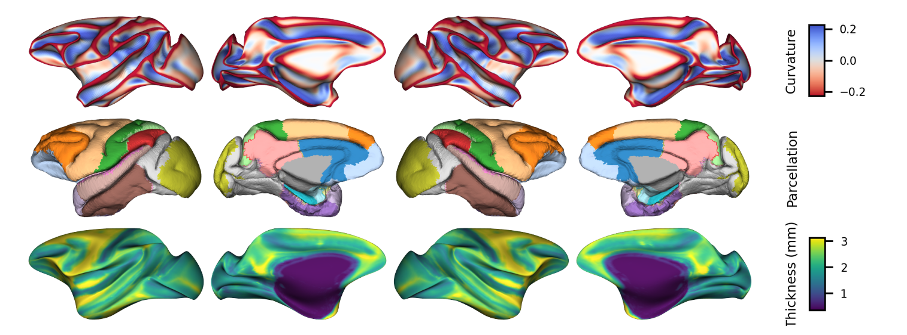

CHARM projection on the surface


Retinotopy
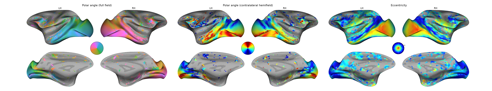

Somatotopy
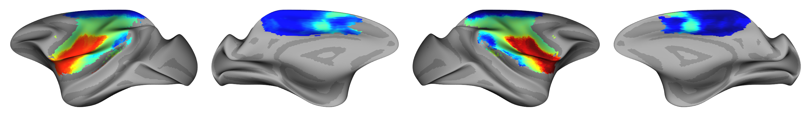

D99
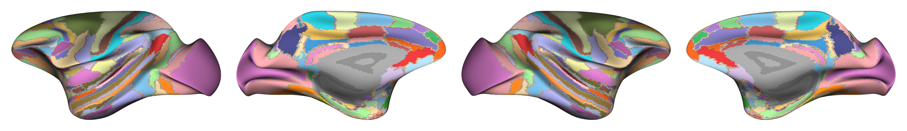

MacBNA
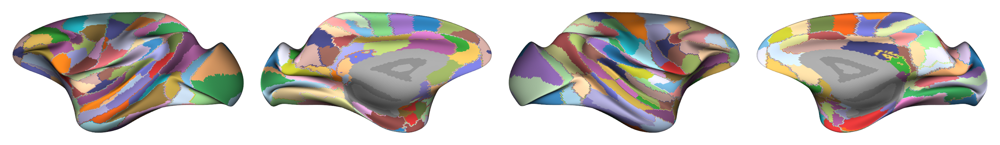

FuncNetwork (lh only)
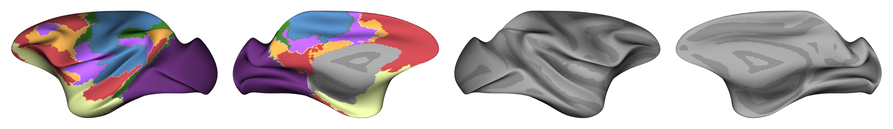

CortHierarchy (lh only)
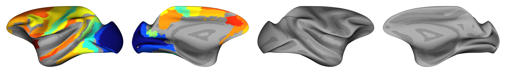

FuncConnGrad, gradients 1 and 2 (lh only)
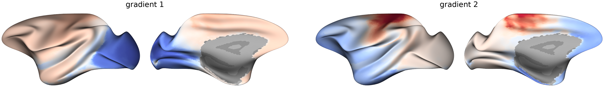

</details>

<details>
<summary><b>NMT2Asym</b></summary>

Tissue segmentation


Cortical surfaces and measures
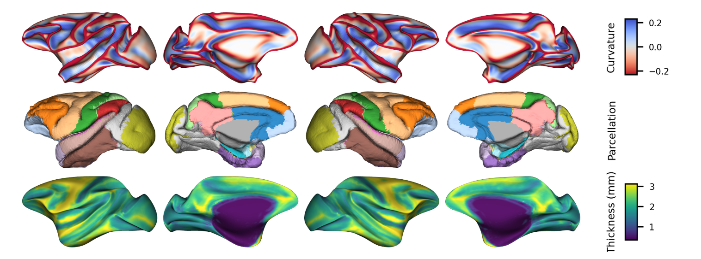

CHARM projection on the surface
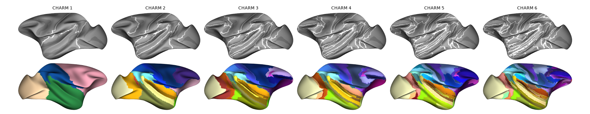

</details>

<details>
<summary><b>MEBRAINS</b></summary>

Tissue segmentation
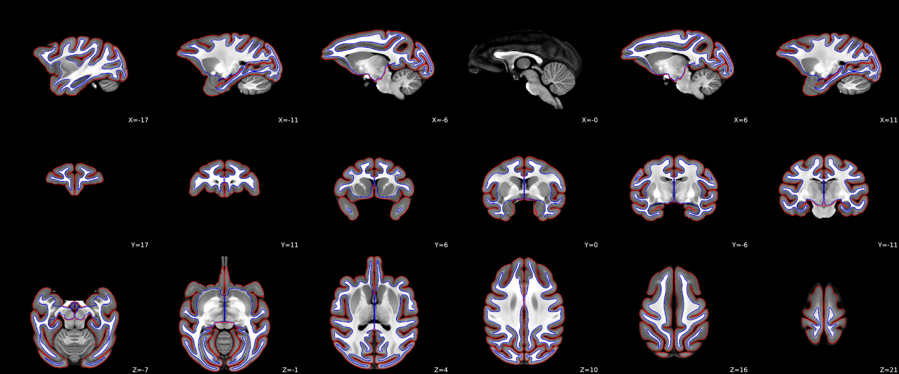

Cortical surfaces and measures
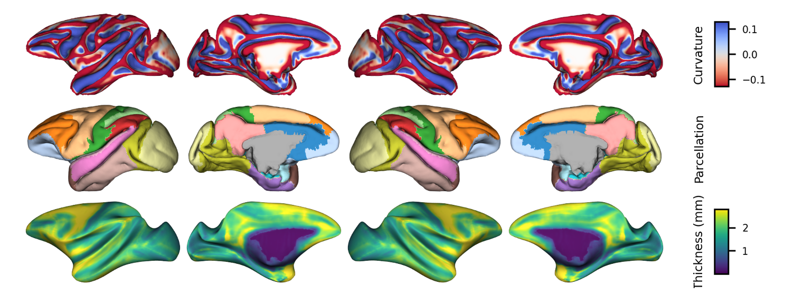

CHARM projection on the surface
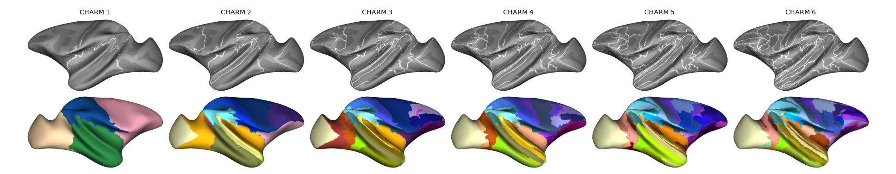

</details>

<details>
<summary><b>Yerkes19</b></summary>

Tissue segmentation
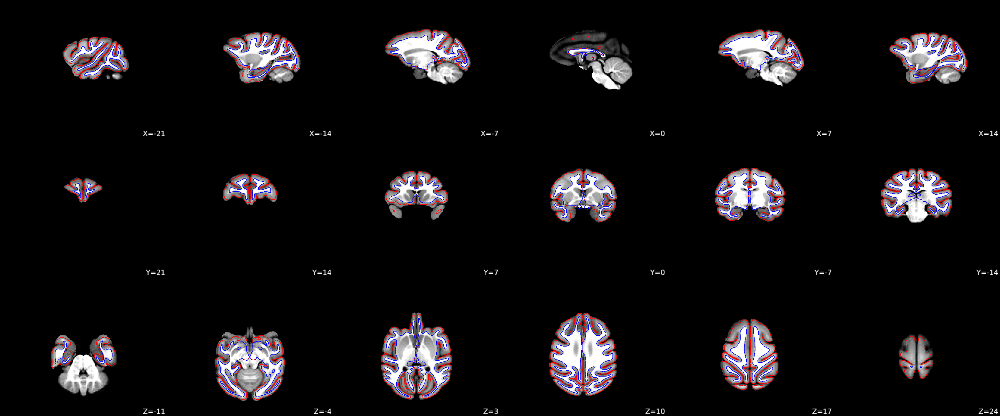

Cortical surfaces and measures
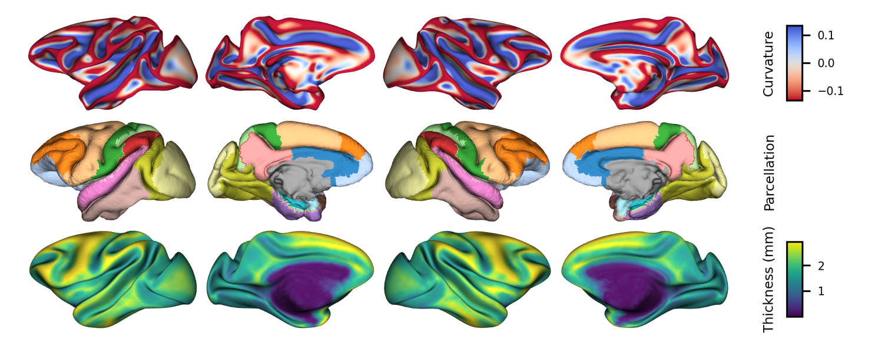

CHARM projection on the surface
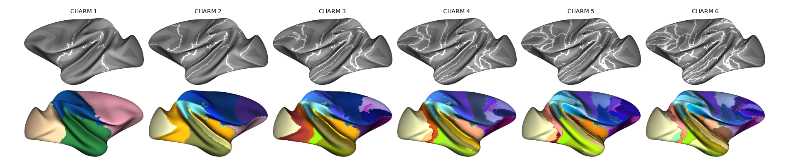

</details>

<details>
<summary><b>D99</b></summary>

Tissue segmentation
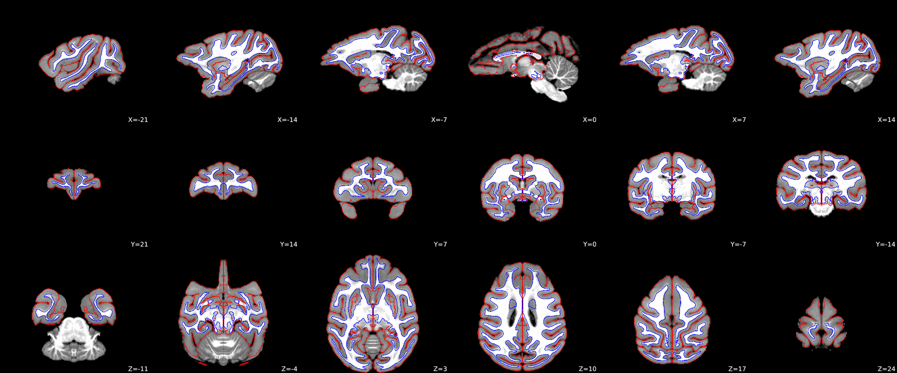

Cortical surfaces and measures
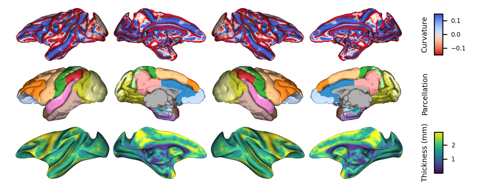

CHARM projection on the surface
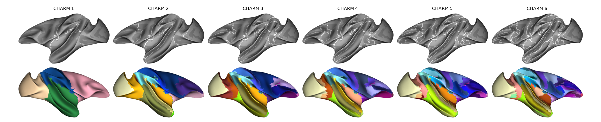

</details>

## Repository structure

```
./
├── sub-xxx/
│   ├── mri/        # Volumetric segmentations and transforms
│   ├── surf/       # Cortical surface meshes (white, pial, inflated, etc.), FreeSurfer + GIfTI
│   ├── label/      # Cortical labels and parcellations
│   ├── atlas/      # Atlases projected on surface, plus atlas-<name>.bib references
│   ├── stats/      # Surface-based statistics
│   └── ...
└── sub-xxx/
    └── ...
```

## Citation and references

When using these surfaces, please cite the respective template, atlas sources (see the `atlas/atlas-<name>.bib` files), and brainana

> [Brainana: an end-to-end preprocessing framework for macaque neuroimaging](https://www.biorxiv.org/content/10.64898/2026.06.03.729972v2) — documentation at <https://brainana.readthedocs.io/>

---

**Keywords:** macaque, rhesus monkey, *Macaca mulatta*, non-human primate (NHP), cortical surface, surface template, FreeSurfer, GIfTI, NMT v2, MEBRAINS, Yerkes19, D99, CHARM, SARM, MacBNA, brain atlas, parcellation, retinotopy, MRI, neuroimaging, Brainana
